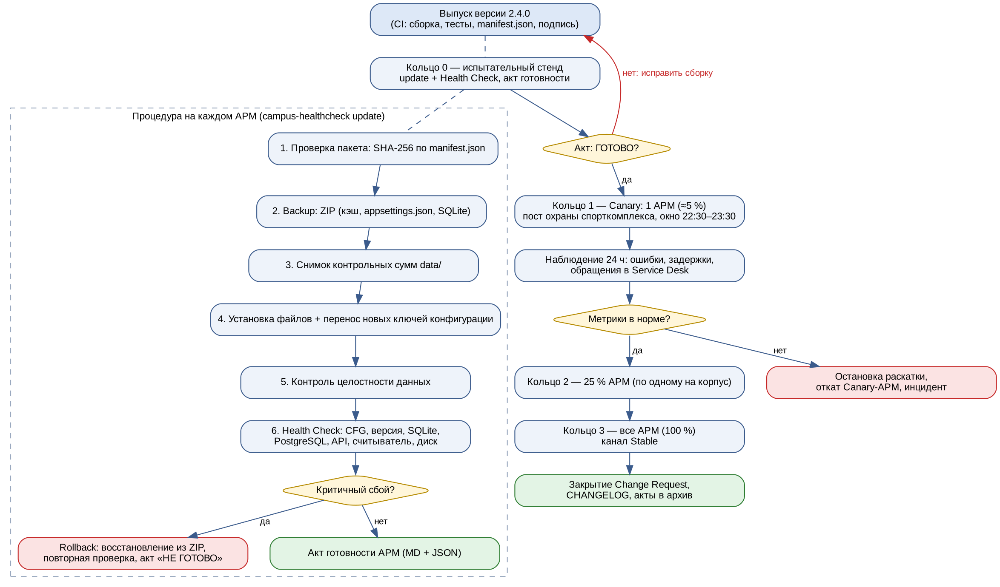

# Регламент непрерывного обновления клиентского ПО АРМ оператора

ИС «Умный кампус» · клиентский модуль «АРМ оператора» · версия регламента 1.0 от 23.10.2026

## 1. Архитектура клиентского модуля (АРМ оператора)

| Компонент | Где находится | Что содержит | Как обновляется |
|---|---|---|---|
| Исполняемые файлы | `C:\Program Files\SmartCampus\Operator\bin` | `Campus.Operator.exe`, библиотеки `*.dll` | заменяются целиком из пакета |
| Конфигурация | `...\Operator\appsettings.json` | адреса API и БД, параметры считывателя, имя переменной с ключом API | **не перезаписывается**; новые ключи переносятся из `appsettings.template.json` |
| Локальная БД SQLite | `...\Operator\data\campus_local.db` | кэш пропусков и журнал проходов на случай потери связи | **не изменяется** обновлением, контролируется SHA-256 |
| Кэш | `...\Operator\cache` | фотографии, справочники | может пересоздаваться |
| Версия | `...\Operator\version.json` | номер версии и канал (Stable/Beta) | пишется последним шагом установки |
| Внешние зависимости | сеть кампуса | центральная БД PostgreSQL, API кампуса, контроллер считывателя (TCP 4001), коллектор телеметрии (4317) | проверяются Health Check |

Центральный сервер обновлений публикует пакеты в общей папке `\\campus-fs\updates\operator\<версия>\`:
файлы версии в подпапке `files\` и `manifest.json` с контрольными суммами SHA-256 каждого файла.

## 2. Схема доставки обновлений (Canary Deployment)



Обновление раскатывается **кольцами** — так ошибку увидит один пост охраны, а не весь кампус:

| Кольцо | Состав | Доля АРМ | Условие перехода к следующему |
|---|---|---|---|
| 0 — стенд | испытательный стенд группы сопровождения | — | акт Health Check «ГОТОВО» |
| 1 — Canary | 1 АРМ: пост охраны спорткомплекса (вход № 2) | ≈ 5 % | 24 часа без критичных ошибок, задержка API < 1,5 с, нет обращений в Service Desk |
| 2 | по одному АРМ в каждом корпусе | ≈ 25 % | 48 часов без инцидентов |
| 3 | все АРМ, канал Stable | 100 % | — |

На серверной стороне (API кампуса) для той же версии применяется **Blue-Green**: новая версия
API разворачивается рядом со старой (`blue` — текущая, `green` — новая), балансировщик переключается
после проверки, старая среда держится 24 часа как «горячий» откат. Поэтому клиент 2.4.0 обязан
работать и со старым, и с новым API (аддитивные изменения контракта).

**Окно обновления АРМ:** 22:30–23:30 (после закрытия спорткомплекса в 23:00 проходов почти нет;
АРМ корпусов — 21:00–22:00). Обновление запускается заданием планировщика от имени
служебной учётной записи `svc-campus-update`.

## 3. Резервное копирование перед обновлением (Backup)

| Что | Как | Где хранится | Срок |
|---|---|---|---|
| весь каталог установки: `appsettings.json`, `data\campus_local.db`, `cache\`, `bin\`, `version.json` | ZIP-архив `backup_<АРМ>_<версия>_<дата>.zip`, создаётся утилитой `campus-healthcheck update` до любых изменений; после создания архив открывается для проверки читаемости | `C:\ProgramData\Campus\backups` + копия в `\\campus-fs\backups\arm\<АРМ>` | 3 последние копии на АРМ, 30 дней на файловом сервере |
| контрольные суммы SHA-256 файлов `data\` | снимок до установки, сравнение после | в акте готовности | вместе с актом |

Перед копированием клиент АРМ закрывается (служба синхронизации останавливается), чтобы файл
SQLite не изменялся во время архивации; утилита проверяет, что файл не заблокирован.

## 4. План безопасного отката (Rollback Plan)

**Автоматический откат** (выполняет `campus-healthcheck update`) запускается, если после установки:

* не пройдена любая **критичная** проверка Health Check (версия, конфигурация, SQLite,
  центральная БД, внешний API, считыватель);
* изменились локальные данные (`data\`) — нарушена целостность.

Порядок отката:

1. Каталог установки очищается и восстанавливается из ZIP-архива, созданного на шаге 2.
2. Проверяется восстановленная версия и совпадение контрольных сумм данных с исходными.
3. Формируется акт «НЕ ГОТОВО — выполнен откат», утилита завершается с кодом **3**.
4. Задание планировщика по коду 3 создаёт инцидент в Service Desk; раскатка останавливается.

**Ручной откат** (если АРМ не запускается после обновления):

```bat
rem 1. закрыть клиент АРМ
taskkill /IM Campus.Operator.exe /F
rem 2. распаковать последнюю копию поверх каталога установки
powershell Expand-Archive -Force C:\ProgramData\Campus\backups\backup_ARM-SPORT-01_2.3.1_*.zip "C:\Program Files\SmartCampus\Operator"
rem 3. проверить результат
campus-healthcheck check
```

Целевое время восстановления (RTO) — 10 минут; потеря данных (RPO) — 0, так как журнал проходов
до обновления синхронизирован с сервером, а SQLite восстанавливается из копии.

## 5. Роли

| Роль | Обязанности |
|---|---|
| Группа сопровождения (разработчик) | сборка пакета, `manifest.json`, CHANGELOG, проверка на стенде |
| Системный администратор | запуск раскатки по кольцам, контроль актов, откат |
| Оператор АРМ | проверка работы после смены (см. OPERATOR_MANUAL.md), сообщение о сбоях |
| Владелец сервиса | согласование Change Request и перехода между кольцами |
